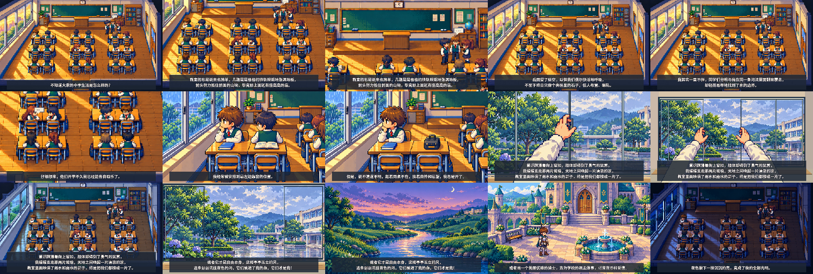
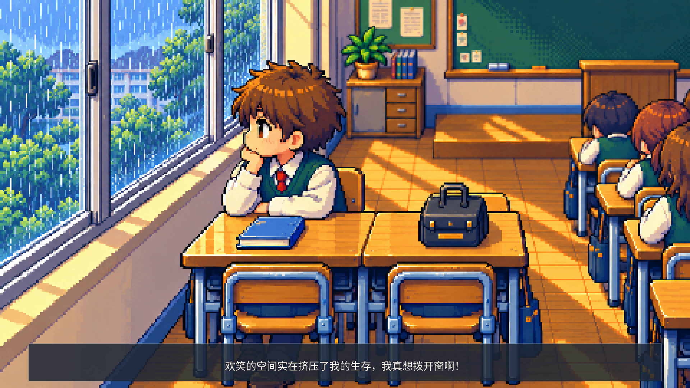

# pixel-video · 窗

根据一篇关于高中教室、窗边孤独与短暂自由的文章制作像素动画。

## 当前制作：丰富分镜第二版 · 曼波朗读

第二版已完成：141 秒，1920×1080，24 fps。保留强像素掌机 RPG A 风格与完整曼波朗读，镜头由 15 个增加至 35 个；加入三排双人桌与后排通道、同桌转头和离席、分阶段第一人称推窗，以及开窗后的室内光色变化。各镜头保持固定，全文 21 句原文字幕已烧入画面，字号由 42 增大至 66，并加粗描边、重新均衡换行。

**[播放或下载新版完整视频](https://raw.githubusercontent.com/2469781075-sys/pixel-video/main/rpg-film/full-film-v2/window-full-mambo-v2.mp4)** · [新版镜头说明](rpg-film/full-film-v2/README.md) · [原文字幕](rpg-film/full-film-v2/subtitles.srt) · [检验记录](rpg-film/full-film-v2/verification.json)



## 第一版：强化像素完整版 · 曼波朗读

全文视频已完成：141 秒（2 分 21 秒），1920×1080，24 fps。采用选定的更强像素风，包含 139 秒全文曼波朗读、21 句逐句原文字幕，以及雨声、风声、推窗音效和低音量原创配乐。

**[播放或下载完整视频](https://raw.githubusercontent.com/2469781075-sys/pixel-video/main/rpg-film/full-film/window-full-mambo.mp4)** · [影片与镜头说明](rpg-film/full-film/README.md) · [原文字幕](rpg-film/full-film/subtitles.srt) · [检验记录](rpg-film/full-film/verification.json)

教室采用成组双人桌、靠窗主人公与暂空同桌位、升高一层的讲台、横向推拉窗。开窗切换第一人称，双手沿轨道滑开窗扇；随后进入窗外、河流与骑士的想象，再回到夜色教室。各镜头保持固定。之前确认的图片与所有小样继续保留。



## 早期首段小样 · 30 秒

已选定 A 掌机 RPG 风格。第一段增加为 26 名学生、修正规则窗格，并保持固定镜头；主人公从读书、望窗，到起身靠近窗扣。

**[打开 30 秒第一段视频](rpg-film/part-01/window-part-01.mp4)** · [画面与分镜](rpg-film/part-01/README.md) · [完整片规划](rpg-film/PLAN.md)

1080p，24 fps，含摘句字幕、雨声与原创合成配乐，无旁白，作为早期版本保留。


## 三种电玩风格静态设计

[打开 A / B / C 设计画廊](designs/game-styles/README.md)：掌机 RPG、等距像素经营、复古像素剧情冒险。人物可调整，既有动画保留。

## 第三版对照：掌机像素角色、固定镜头

第二版原样保留。本版人物参考宝可梦经典掌机游戏的清晰轮廓、紧凑少年比例和简洁分色，保留棕发、青绿校服及托腮望窗的原创设定；暖色教室背景直接沿用第二版。

**[打开固定镜头版视频](sample-v3/window-still.mp4)** — 点击 **Download raw file** 下载观看。

24 秒，1280×720。全程固定机位，人物保持坐姿，仅低频眨眼；细雨、少量微粒和缓慢入夜保持轻微环境动态。字幕与音频沿用第二版方案。


- [对照版分镜](sample-v3/storyboard.png)
- [制作说明](sample-v3/PLAN.md)

复现命令：`python3 sample-v3/render.py`。此版本依赖第二版中的背景文件，请保留两版目录。

## 第二版：可爱、精细的像素风

圆润的小人物、暖木色课桌、薄荷色窗框、雨中的绣球花和柔和窗光。

**[打开新版视频](sample-v2/window-cute.mp4)** — 点击视频文件页面右上角的 **Download raw file** 下载观看。

24 秒，1280×720，16 fps；含原文摘句字幕、角色呼吸与眨眼、动态雨滴、镜头运动、入夜变化，以及合成雨声、风声和稀疏音符。没有旁白；这是美术与轻动作样片，完整推窗表演尚未制作。


- [四帧分镜](sample-v2/storyboard.png)
- [美术关键帧](sample-v2/assets/keyframe.png)
- [制作规划](sample-v2/PLAN.md)
- [渲染脚本](sample-v2/render.py)

## 复现

系统需有 FFmpeg 与 Noto CJK 字体；安装 `sample-v2/requirements.txt` 中的 Python 依赖，然后从仓库根目录执行：

```sh
python3 sample-v2/render.py
```

美术图层已存入仓库，无需再次调用图像生成服务。音频由脚本本地合成。

[第一版小样](sample/window.mp4)保留用于比较。
