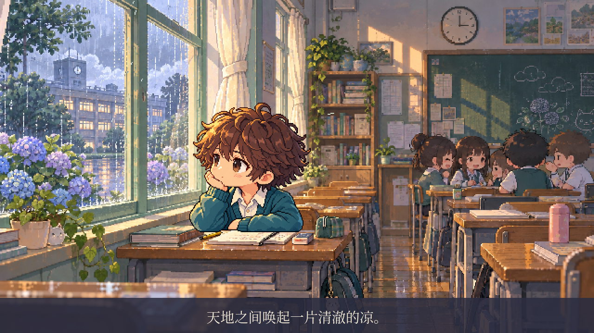
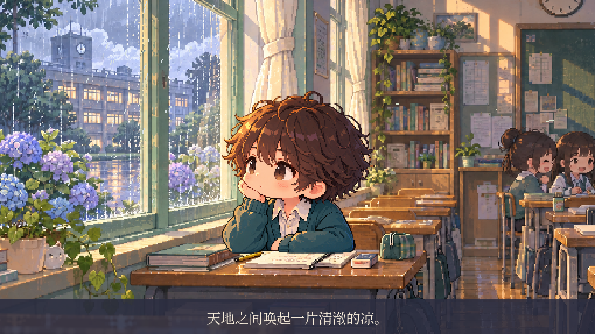

# pixel-video · 窗

根据一篇关于高中教室、窗边孤独与短暂自由的文章制作像素动画。

## 第三版对照：掌机像素角色、固定镜头

第二版原样保留。本版人物参考宝可梦经典掌机游戏的清晰轮廓、紧凑少年比例和简洁分色，保留棕发、青绿校服及托腮望窗的原创设定；暖色教室背景直接沿用第二版。

**[打开固定镜头版视频](sample-v3/window-still.mp4)** — 点击 **Download raw file** 下载观看。

24 秒，1280×720。全程固定机位，人物保持坐姿，仅低频眨眼；细雨、少量微粒和缓慢入夜保持轻微环境动态。字幕与音频沿用第二版方案。



- [对照版分镜](sample-v3/storyboard.png)
- [制作说明](sample-v3/PLAN.md)

复现命令：`python3 sample-v3/render.py`。此版本依赖第二版中的背景文件，请保留两版目录。

## 第二版：可爱、精细的像素风

圆润的小人物、暖木色课桌、薄荷色窗框、雨中的绣球花和柔和窗光。

**[打开新版视频](sample-v2/window-cute.mp4)** — 点击视频文件页面右上角的 **Download raw file** 下载观看。

24 秒，1280×720，16 fps；含原文摘句字幕、角色呼吸与眨眼、动态雨滴、镜头运动、入夜变化，以及合成雨声、风声和稀疏音符。没有旁白；这是美术与轻动作样片，完整推窗表演尚未制作。



- [四帧分镜](sample-v2/storyboard.png)
- [美术关键帧](sample-v2/assets/keyframe.png)
- [制作规划](sample-v2/PLAN.md)
- [渲染脚本](sample-v2/render.py)

## 复现

系统需有 FFmpeg 与 Noto CJK 字体；安装 `sample-v2/requirements.txt` 中的 Python 依赖，然后从仓库根目录执行：

```sh
python3 sample-v2/render.py
```

美术图层已存入仓库，无需再次调用图像生成服务。音频由脚本本地合成。

[第一版小样](sample/window.mp4)保留用于比较。
