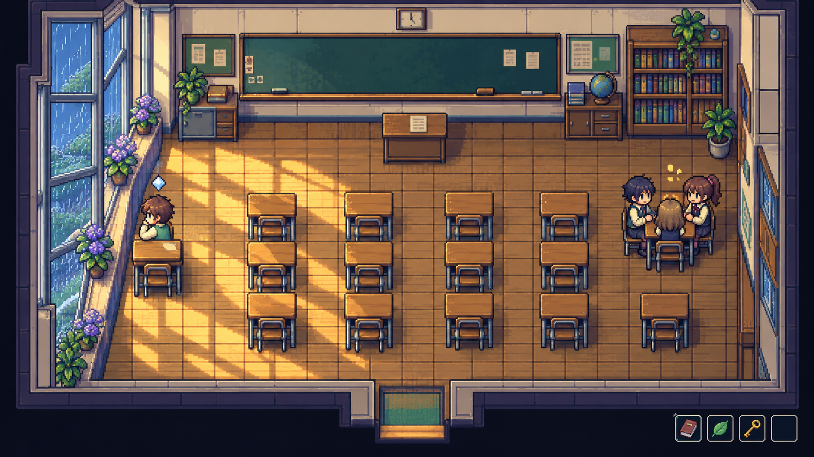
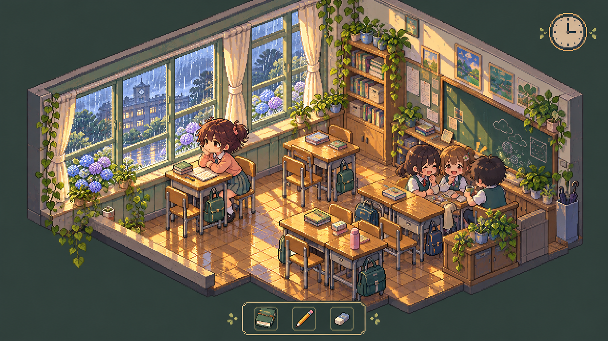
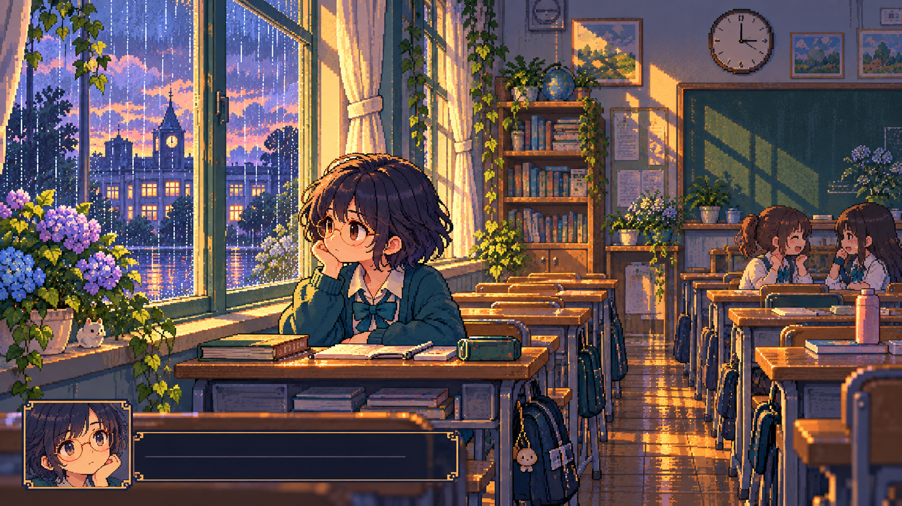

# 《窗》· 三种电玩风格静态设计

保留教室、窗边、雨景、暖色木桌与孤独的氛围，分别尝试三种角色和空间设计。本次仅制作静态设计图，既有动画版本保持不变。

| 方案 | 画面与人物 | 适合的方向 |
| --- | --- | --- |
| A · 掌机 RPG | 三分之四俯视、整齐地图格、棕发小少年、奶油与薄荷色 | 接近经典掌机游戏，方便制作走动、互动与分镜 |
| B · 等距像素经营 | 斜俯视教室、小家具、双丸子头学生、柔和绿与桃色 | 更可爱，像可以摆弄的教室小世界 |
| C · 复古像素剧情冒险 | 横向场景、蓝发圆眼镜学生、紫蓝暮色与暖窗光 | 更强调文章情绪，适合近景与独白 |

## A · 掌机 RPG

## B · 等距像素经营

## C · 复古像素剧情冒险

这些图用于选择美术方向；图中的界面元素也是设计示意，并非已实现的游戏功能。
