# 《窗》完整静态分镜 · 强像素版

**16 张关键图对应原文全部 21 句。** 本轮补绘 12 个画面，统一前三张核心图的像素风，开窗后的第 4 张直接采用已有更强像素版本。用户已认可原四张核心构图；新增画面与统一画风的版本供本轮检查。之前所有图与视频继续保留。

**[下载完整原图包与离线画廊](https://raw.githubusercontent.com/2469781075-sys/pixel-video/main/rpg-film/complete-storyboard/window-complete-storyboard.zip)**

下载解压后打开 `index.html`，点击图片查看大图与完整原文，用左右方向键切换。本页面也可以直接向下浏览所有图片。

当前交付是完整静态分镜，不含动画和音频。正式视频继续按原文顺序使用全文曼波朗读、大字幕与单镜头固定相机；这些图为构图、角色状态和画风依据，不是已经完成的重制成片。

第 13 张图上展示原句前半段，完整第 17 句仍保存在下面的引用、原文文件及分镜记录中。图像工具拦截了含原句全文的初稿绘图请求，修改后的画面为普通校园交流；没有据此改写正式旁白文案。

| 图 | 画面 | 对应原文序号 |
| --- | --- | --- |
| 01 | 教室的拥挤 | 1、2 |
| 02 | 桌列与高台 | 3 |
| 03 | 后排的呼吸 | 4 |
| 04 | 找不到河流的边界 | 5 |
| 05 | 同学的小世界 | 6、7 |
| 06 | 靠窗与欢笑的挤压 | 8、9 |
| 07 | 方格里的梦想 | 10 |
| 08 | 目光与沉默 | 11、12 |
| 09 | 同桌离席，伸向窗扣 | 13 |
| 10 | 第一人称横向推窗 | 14 |
| 11 | 风进入教室 | 15 |
| 12 | 风与流向夜色的河 | 16 |
| 13 | 意气风发的想象 | 17 |
| 14 | 优雅骑士与学校的君主 | 18 |
| 15 | 回到原位，仍跑不出去 | 19、20 |
| 16 | 夜色里的全部光明 | 21 |

## 01 · 教室的拥挤

> 不知道大家的中学生活是怎么样的？
>
> 主播高中的教室是狭窄逼仄的。

建立教室空间与主人公位置，保留已确认核心构图。

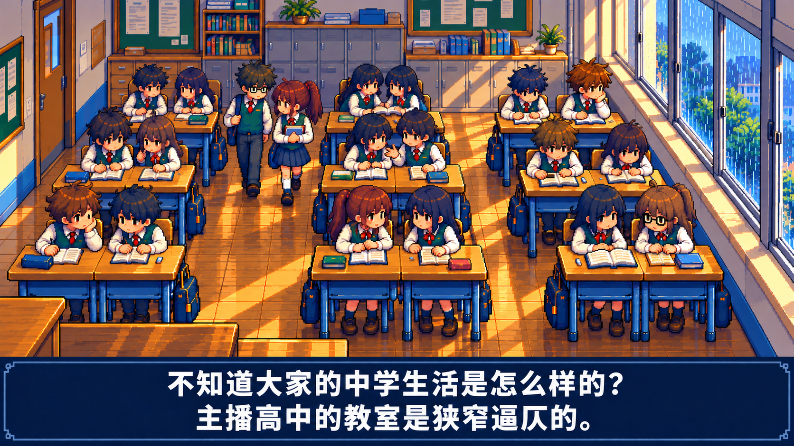

## 02 · 桌列与高台

> 教室的布局说来也简单，几路层层格格的铁轨规矩地张满地板，前头努力抵住前面的山坳，毕竟那上面还有座高高的庙。

用桌腿与地砖引线、清晰的一层高台和台上讲桌表现原文比喻。

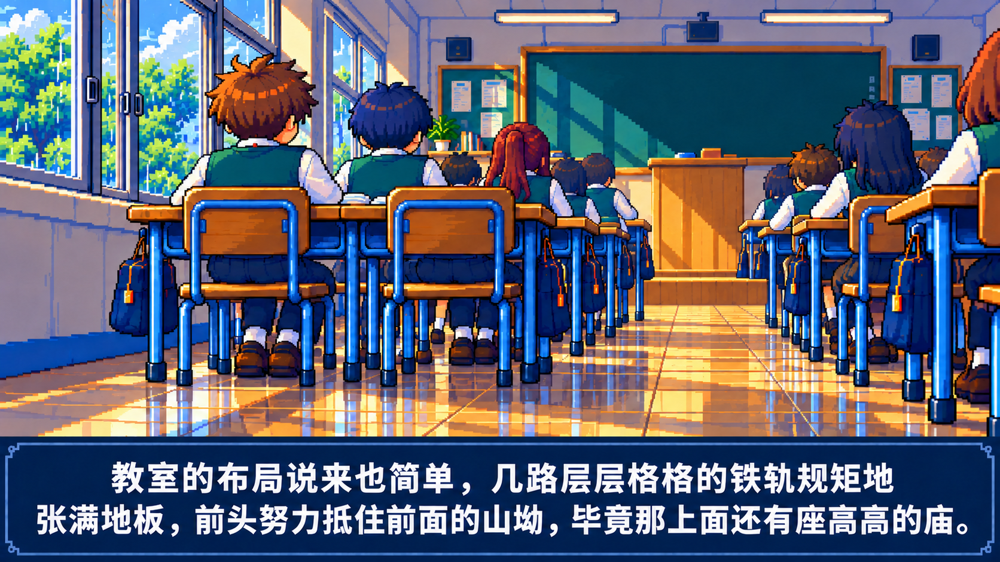

## 03 · 后排的呼吸

> 后面留了些空，以供我们偶尔快活地呼吸，不至于终日只做个夹层里的石子，任人布置、碾轧。

展示真实后排通道与站立交流，把拥挤中的空隙画出来。

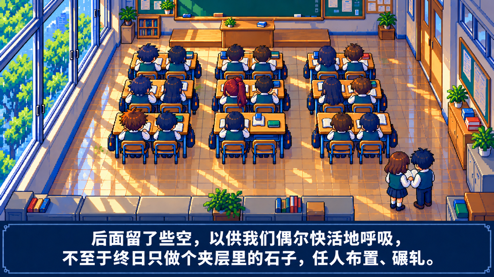

## 04 · 找不到河流的边界

> 我其实一直不懂，同学们分明与我在同一条河流里面翻来覆去，却轻而易举地找到了水的边界。

以主角停在河中踏石、同学已走上河岸表现同在河流却找不到边界。

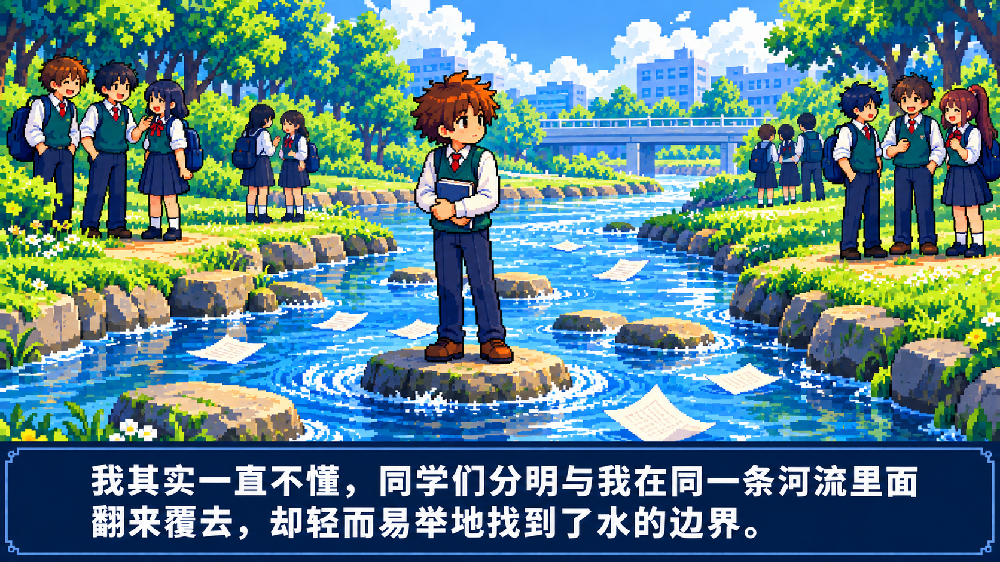

## 05 · 同学的小世界

> 仔细想来，他们开学不久就已经能各自取乐了。
>
> 他们围成了一个个小小世界，讲述着我听不懂的历史。

保留已确认群像，用具体阅读交流与主角的距离表现各自取乐。

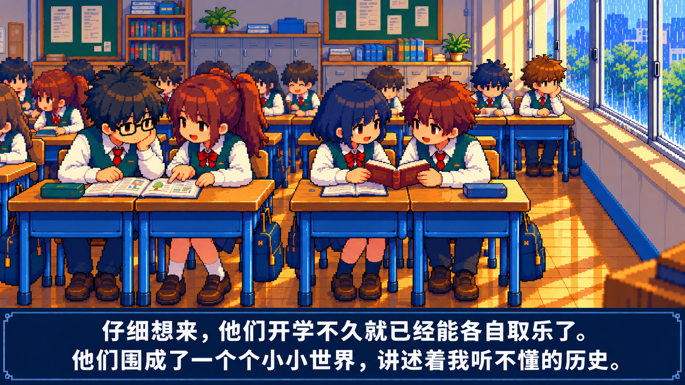

## 06 · 靠窗与欢笑的挤压

> 我经常被安排到最左边靠窗的位置。
>
> 欢笑的空间实在挤压了我的生存，我真想拨开窗啊！

用正常窗边座位、未完成的作业和旁边的交流表现想开窗的动机。

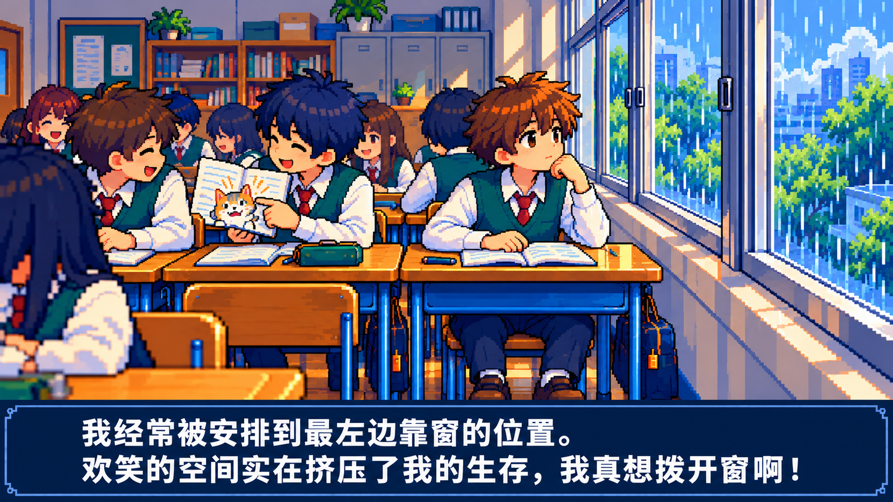

## 07 · 方格里的梦想

> 那四四方方的格子里，或许住着一个梦想也说不定。

独立窗格细节把梦想放在玻璃外，主角倒影留在室内。

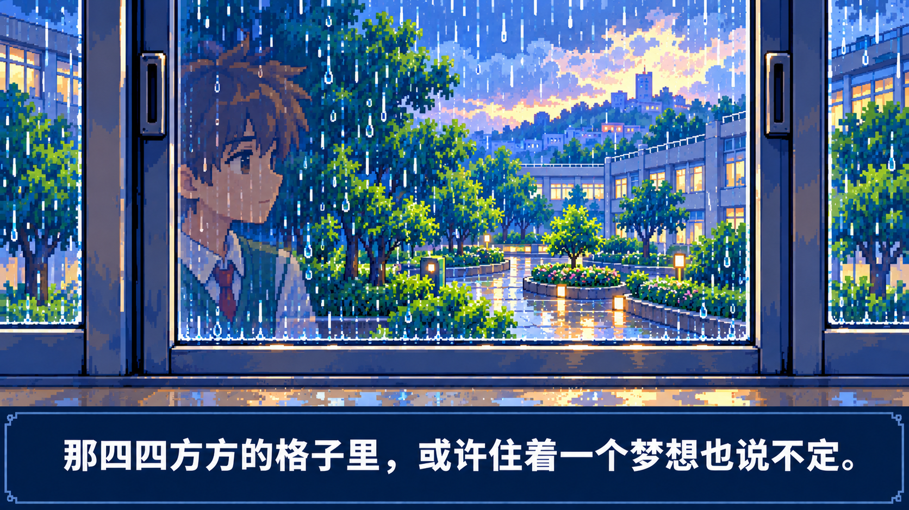

## 08 · 目光与沉默

> 只是我能经受灼热目光的冒险吗？
>
> 我本就不知道怎么办了，我孤冷又沉默，淫秽却无聊......

用收肩、低头、攥笔和同学的短暂视线表现犹豫与沉默。

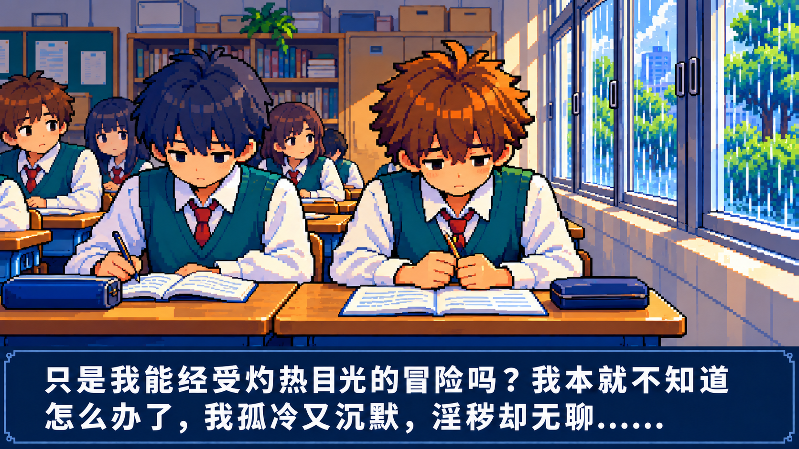

## 09 · 同桌离席，伸向窗扣

> 但是，说不清道不明，趁着同桌不在，挟着自怜和愿望，我总是开了。

让同桌真实离开原座位，空椅与物品留下，主角才伸手触窗。 这一张延续开窗后核心图的室内机位，重绘主角伸手和同桌离席的状态，用于连续叙事。

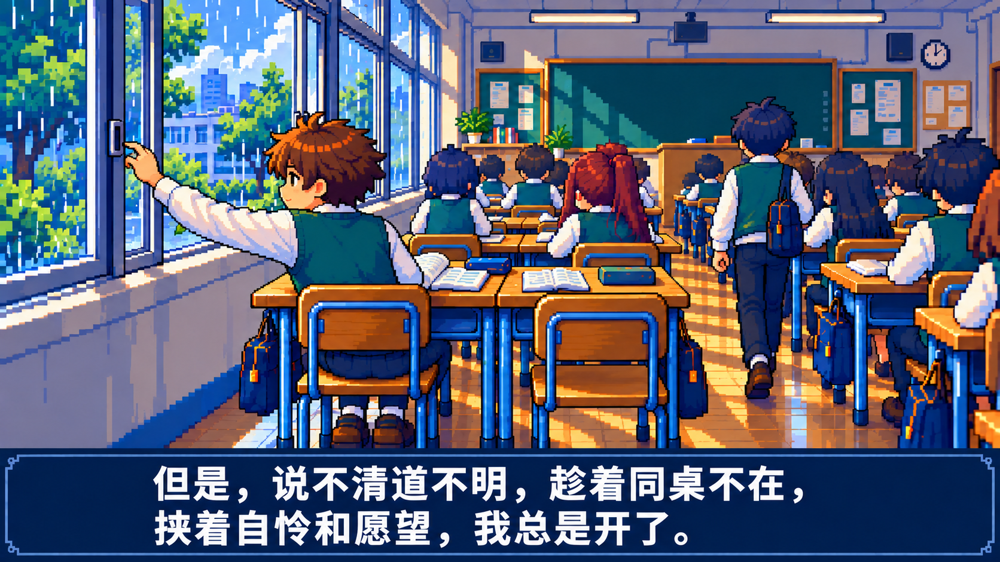

## 10 · 第一人称横向推窗

> 意识蹒跚着爬上窗扣，肢体却得到了勇气的奖赏，我缓缓支走那两片玻璃，天地之间唤起一片清澈的凉，教室里面映满了雨水和露水的影子，终是把我们都接成一片了。

保留已确认第一人称构图，统一像素颗粒与窗户的水平轨道。

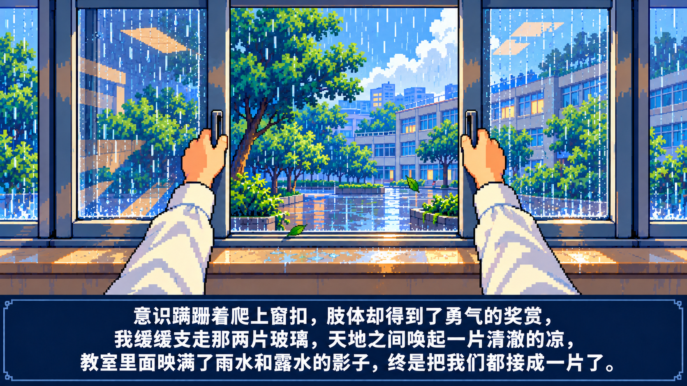

## 11 · 风进入教室

> 我享受这份拥抱，因为它赞许了我们的自由。

保留强像素核心图，表现开窗后的纸页、发梢、光色与主角状态。

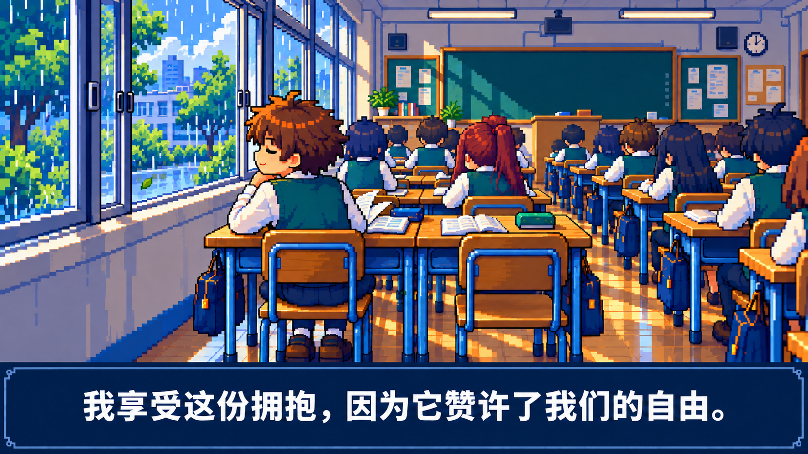

## 12 · 风与流向夜色的河

> 或者它才是自由本身，这缕亭亭玉立的风，这条潺潺流往夜色的河，它们融进了我的血，它们才是我！

把风、河流与主角连成同一运动方向，并让河流延伸入夜色。

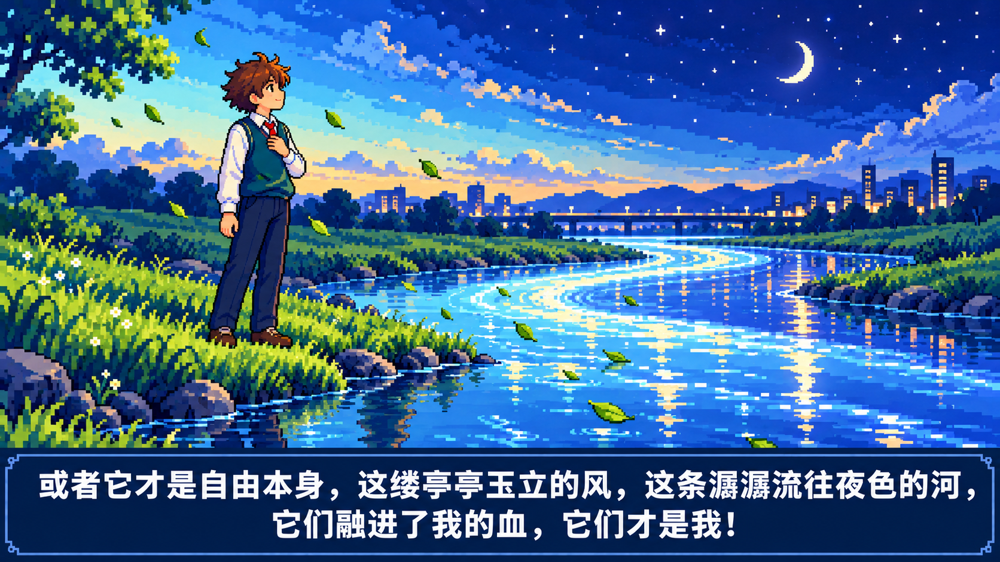

## 13 · 意气风发的想象

> 是的，我不是一个弱小的学生，我本也可以意气风发，学着男同学去和女同学调笑，享受她们的娇嫩欲滴。

画出主角幻想中的主动交流与自信，人物保持自然、完整的校服形象。 图上的大字幕只展示这一句的前半段。

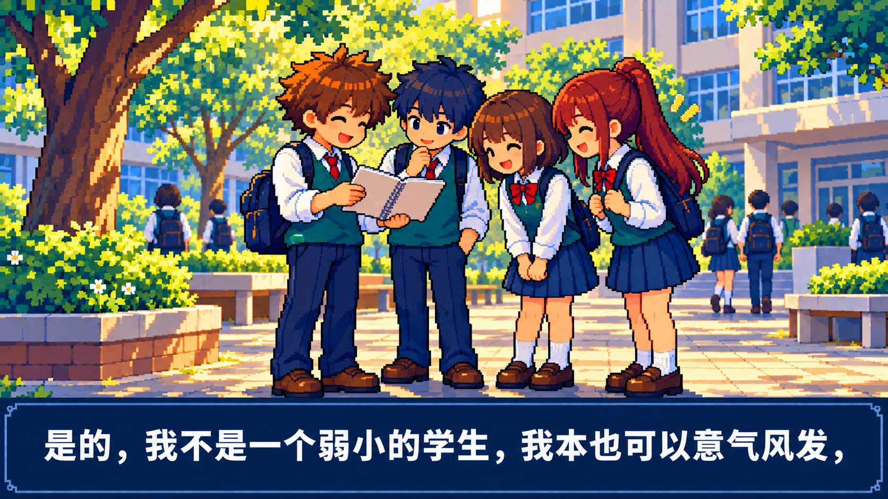

## 14 · 优雅骑士与学校的君主

> 或者当一个美丽优雅的骑士，去为学校的君主做事，讨来货币和爱情。

为骑士联想绘制全新幻想场景，用高台和绿色墙面呼应现实教室。

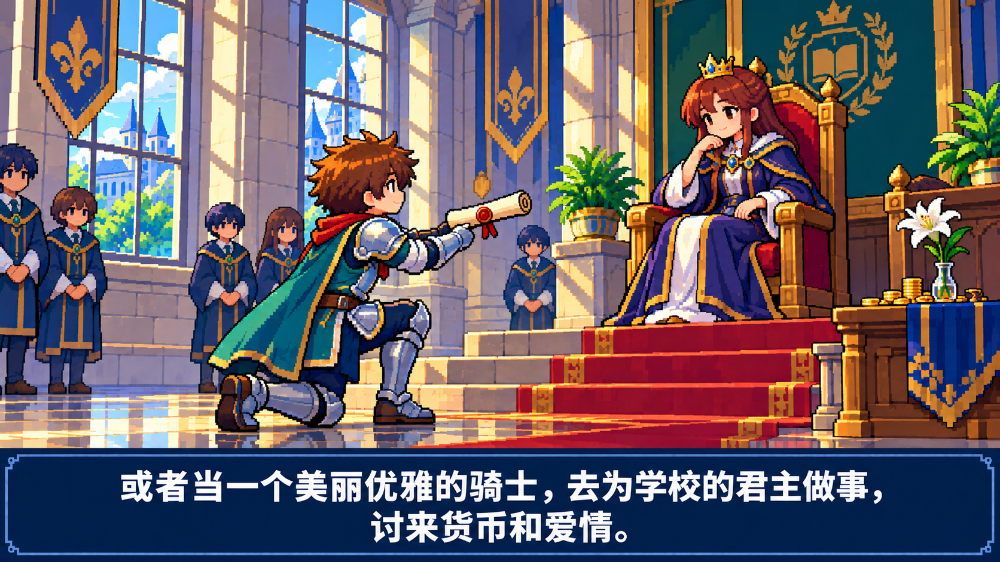

## 15 · 回到原位，仍跑不出去

> 但是我不会去做的，我只是想保持现状，因为我根本不知道怎么才能办得到啊。
>
> 我还是跑不出那间教室啊，那阵风成了我的症候。

通过合上想象中的书、恢复校服和原座位、暮色变暗表现保持现状与受困。

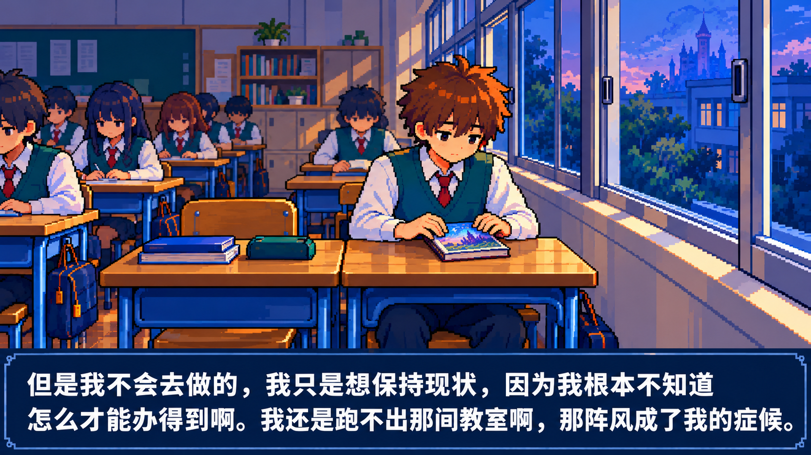

## 16 · 夜色里的全部光明

> 夜色撇下一抹沉沉的亮，竟成了我的全部光明。

让窗光成为脸和纸页上唯一清楚的亮色，用新的夜间近景收住全文。

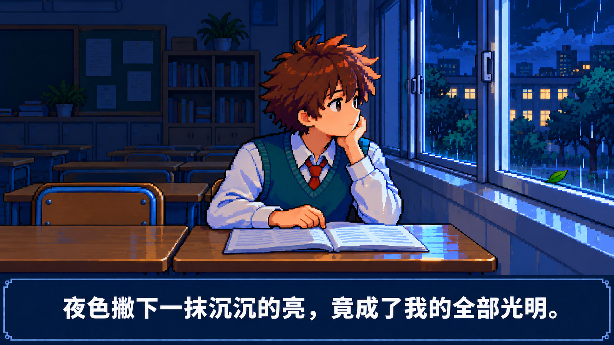

## 保存与检查

- 四张核心构图保留，其中三张为像素风与字幕统一版，第 11 张直接复用已生成的更强像素开窗后画面。12 个新增画面用于原文中的其他时刻；同桌离席图延续同一机位，表达有意义的状态变化。
- 逐图查看了主角桌椅关系、窗轨与外框、周边人物和对应字幕。第 2 张的多层台阶已修成一层高台；第 3 张初稿没能展示后排留空，已重新绘成俯视图。第 8 张句末六个点另作只读核对，保持原文标点。
- 室内画面的窗墙随视角投影在左侧或右侧；主角与同桌使用同组并桌。河流、校园自信与骑士为心理联想，不把教室真的变成河流或城堡。
- 分镜文字完整覆盖 21 句，图 13 的字幕示意例外有单独记录。字幕换行只是展示；正式视频应从原文文件和曼波实测时间轴单独生成。
- PNG 可读性、文件完整性、原文顺序和覆盖关系已检查。数字检查不代替用户的美术验收；连续动作、手窗接触、逐帧遮挡和精确背景连续性需要在动画阶段检查。

[全部原文](original.txt) · [逐句镜头记录](shots.json) · [生成及修正提示](assets.json) · [第 13 张字幕说明](caption-exception.json) · [原曼波实测时间轴](narration-timings.json) · [文件检查记录](verification.json)
