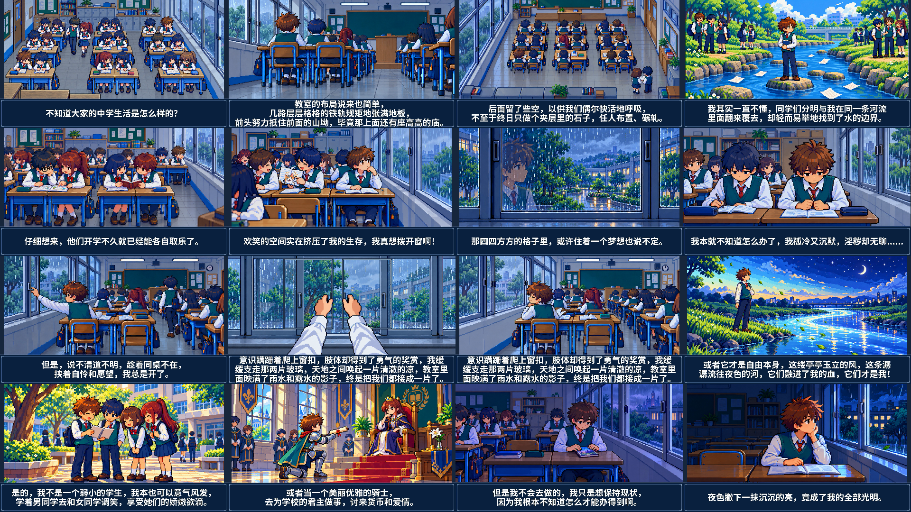

# 《窗》· 轻颗粒雨天版 · 曼波朗读

完整动画已合成：2 分 21 秒，1920×1080，24 fps。沿用已确认的 16 张掌机 RPG A 分镜与人物，雨天教室改为阴天漫射光，回到教室及结尾为暮色、夜色。使用轻颗粒材质，保持单镜头机位固定。

**[播放或下载完整 MP4](https://raw.githubusercontent.com/2469781075-sys/pixel-video/main/rpg-film/film-light-rain/window-light-rain-mambo.mp4)** · **[下载离线交付包](https://raw.githubusercontent.com/2469781075-sys/pixel-video/main/rpg-film/film-light-rain/window-light-rain-delivery.zip)**

交付包解压后打开 `index.html` 即可播放本地视频，也可直接打开 MP4。包中包括完整视频、原文字幕、曼波音轨、实际成片概览和时间轴。



## 画面与声音

- 保留已确认的教室布局、角色配色、成组双人桌、一层讲台及全部构图；教室雨景去掉直射阳光、金色窗台和地面光斑。窗玻璃倒影一幕使用阴雨暮色，户外灯保留柔和电灯光。河流、社交与骑士的幻想画面沿用原有设定。
- 粒子、纹理保持轻量；材质颗粒不逐帧随机跳动。环境只做窗外雨滴、局部水纹、少量风叶及书页动作，相机保持固定。
- 同学交谈使用局部嘴部关键帧，主人公有短暂眨眼；同桌沿过道离席，主人公由放手、抬手到触及窗扣。透明人物部件以脚底坐标定位，配合接触阴影。
- 开窗切第一人称，双手接触把手，两片固定尺寸的窗扇沿水平轨道滑开，最后放下双手；随后切到已确认的开窗后教室画面。暮色教室包含展开书页与合书两个姿态。
- 复用现有 139 秒全文曼波朗读，原速播放，全文 21 句不删改。雨声和两处轻微音效保持低音量；结尾留 2 秒收尾。
- 大号中文字幕单句显示、最长三行。正式字幕独立渲染，不使用 PNG 中的预览文字；包含第 17 句全文。

## 文件

| 文件 | 用途 |
| --- | --- |
| [完整视频](window-light-rain-mambo.mp4) | H.264 / AAC，字幕已烧录，16 个章节 |
| [离线播放页](index.html) | 本地播放、章节跳转、下载 |
| [原文 SRT](subtitles.srt) / [烧录 ASS](subtitles.ass) | 21 句原文与大字幕排版 |
| [曼波音轨](mambo-narration.mp3) | 既有完整朗读，原文件保留 |
| [原文](original.txt) / [实际配音时间轴](narration-timings.json) | 文案与逐句实测时长 |
| [镜头表](shots.json) / [渲染计划](render-plan.json) | 16 镜头、动作、声画规格 |
| [灯光编辑记录](lighting-edits.json) / [动作素材记录](animation-assets.json) | 内置 image_gen 的参考图、提示和选定输出 |
| [技术检查](verification.json) | 解码、文本、音轨覆盖、固定镜头与来源保留 |
| [动作关键帧概览](encoded-action-sheet.png) / [代表帧时间](preview-times.json) | 实际编码视频的开窗与合书动作 |

`assets/` 保存 16 张正式画面，`assets/animation/` 保存 11 张局部姿态及透明部件。原完整分镜、两张修订图、轻颗粒版和强颗粒版共 22 张源 PNG 均保持原文件；此前视频继续保留。位图编辑使用内置图片工具，动画合成使用本项目的 Python/Pillow/FFmpeg 流程。

## 检查与复现

完整声画解码通过。SRT 和烧录 ASS 逐字重建原文，21 段配音时长与时间轴一致；实际 MP4 中各句声音与原始 PCM 的波形相关度均超过 0.9995。实际混音为 −16.09 LUFS，真峰值 −1.45 dBTP。

检查了 16 镜头及开窗、合书代表帧，查看人物落地、桌椅关系、手与窗扇连接、阴雨光线和大字幕。程序检查覆盖全部声明动作区域之外的固定像素，并抽查实际编码视频的相机位移；这些检查不替代用户对画面、节奏或朗读的评价。

需要 Python、Pillow、NumPy、FFmpeg/libass 和系统 Noto CJK 加粗字体。仓库中的原始曼波 WAV 归档已经齐备，复现无需重新启动或下载语音模型。

```sh
python rpg-film/film-light-rain/render.py --dry-run
python rpg-film/film-light-rain/render.py
python rpg-film/film-light-rain/verify.py
python rpg-film/film-light-rain/build_delivery.py
```

局部导出示例：`python rpg-film/film-light-rain/render.py --sample 66.94:86.35`。缓存、中间音轨和编码日志位于忽略的 `_work/`。
