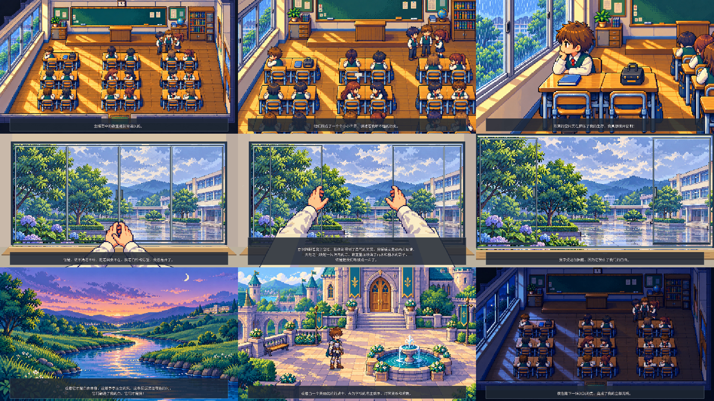

# 《窗》· 强化像素完整动画

**[播放或下载完整视频](https://raw.githubusercontent.com/2469781075-sys/pixel-video/main/rpg-film/full-film/window-full-mambo.mp4)**

141 秒（2 分 21 秒），1920×1080，24 fps，H.264 视频、AAC 立体声。采用用户选定的更强像素风，包含全文 139 秒曼波朗读、原文 21 句字幕，以及低音量原创配乐、雨声、风声和推窗音效。

画面依次进入拥挤教室、同学的小世界、靠窗的主人公、第一人称开窗、清凉的窗外、河流和骑士的想象，再回到夜色中的教室。双人课桌、暂时空着的同桌位、升高一层的讲台和横向推拉窗贯穿现实场景。开窗时，两片活动玻璃沿水平轨道移动并叠到两侧玻璃前，形成真实通风口；外框、窗台固定，双手跟随窗扇，开窗后放下。

采用像素分层动画：主人公眨眼，局部书页与交谈气泡、雨点、微风、水光、独立骑士人物步行，以及第一人称双手和推拉窗动作。各镜头保持固定，只在剪辑点切换构图；不使用持续推拉或整幅画面晃动。文案整句显示，较长的句子只作排版换行，配音保持原合成速度。

[原文逐句字幕](subtitles.srt) · [镜头与动作时间轴](shots.json) · [渲染脚本](render.py) · [检验记录](verification.json) · [曼波原始音轨与分句时间轴](../narration/mambo/README.md)



## 复现

需要 FFmpeg（含 libass）、Noto CJK 字体，以及本目录 `requirements.txt` 中的 Python 依赖。从仓库根目录运行：

```sh
python rpg-film/full-film/render.py
```

素材保存在 `assets/`，无需再次生成图片或配置语音模型。脚本从已交付的 `../narration/mambo/mambo-narration.zip` 读取完整 WAV，重新合成低音量环境声并渲染成片。使用 `--preview-only` 可只生成代表帧。`shots.json` 记录各镜头对应原文句子及动作。

之前的[四张保留图](../scene-review/README.md)、[像素强度对照](../scene-review/pixel-style-comparison/README.md)和各版小样继续保留。
