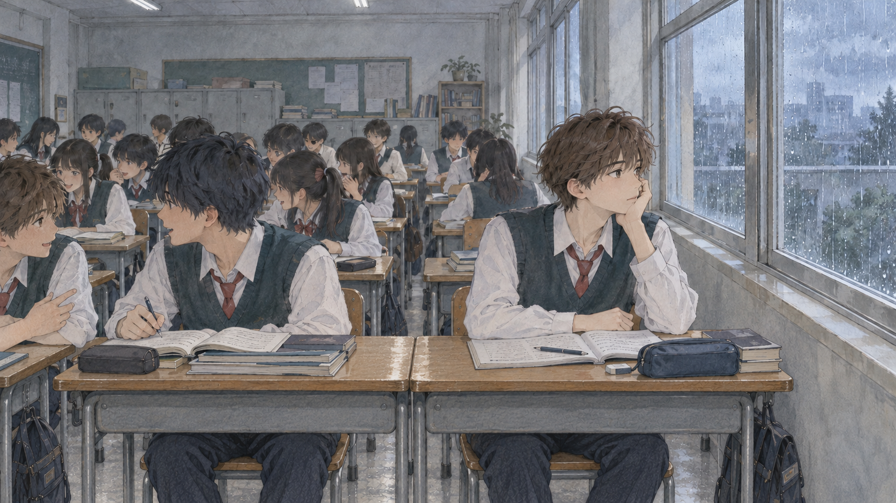
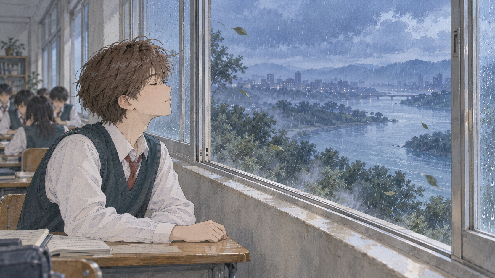

# 《窗》· 手绘水彩风格检查图

两张静态画风试作，以铅笔人物线条、低饱和水彩和纸张纹理表现原文中的孤独与短暂舒展。保留棕发、青绿背心、白衬衣与红领带的主人公识别特征；新图供用户比较画风。

**[下载两张原图](https://raw.githubusercontent.com/2469781075-sys/pixel-video/main/rpg-film/handdrawn-style-review/two-handdrawn-keyframes.zip)**

## 图一：阴雨教室

同学交谈、主人公托腮望窗。前排主人公和深蓝发同桌坐在两张相接的课桌后，桌缝位于两人之间；教室用阴天漫射光。镜头从前方向后看，学校实际左侧的窗墙投影到画面右侧。前景鞋部未完整入画，本图不作为全身脚底检查图。

## 图二：开窗之后

改用窗边侧面构图，主人公闭眼感受凉风；窗外院景进入河流与夜色的想象。主人公仍坐在真实教室里，铅笔线条与水彩延续图一。

图片使用内置 image_gen 生成和编辑，最终提示、参考及输出记录在 [asset-prompts.json](asset-prompts.json)。此前像素风原图和正式视频继续保留。此处为静态风格探索，未制作新动画或配音，尚未视为用户选定的新画风。
