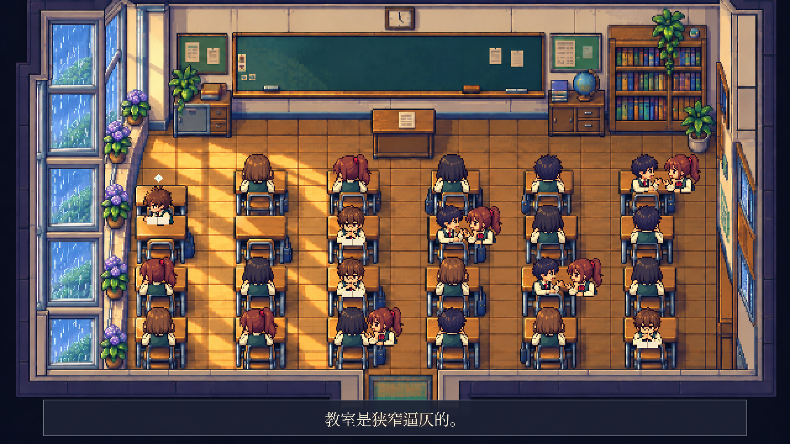
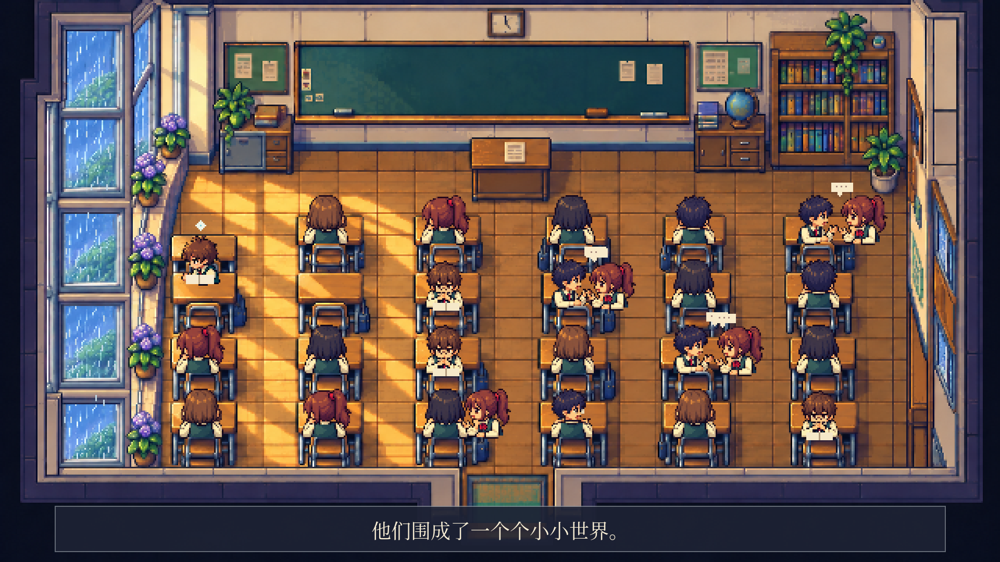
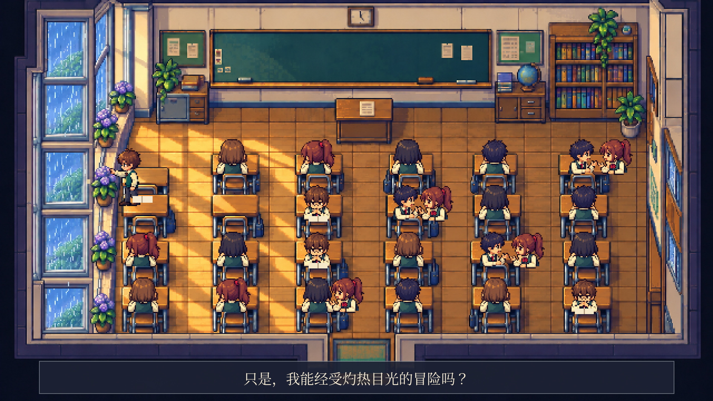

# 《窗》掌机 RPG · 正式动画第一段

本段 30 秒，对应完整片暂定 90 秒的前 1/3。采用选定的 A 掌机 RPG 风格，修正规则窗格、增加到 26 名独立学生角色，并保持固定机位。

**[打开第一段视频](window-part-01.mp4)** — 点击 **Download raw file** 下载观看。

1920×1080，24 fps，H.264 视频与 AAC 立体声。含原文摘句字幕、雨声、翻书和脚步音效、原创合成配乐；没有旁白。角色与背景使用独立图层，包含交谈、转头、翻书和主人公起身、靠近窗扣的动作。

[完整制作规划](../PLAN.md) · [外挂字幕](subtitles.srt) · [渲染脚本](render.py)

## 01 · 拥挤教室 · 0–10 秒

「教室是狭窄逼仄的。」



## 02 · 小小世界 · 10–20 秒

「他们围成了一个个小小世界。」



## 03 · 窗边的梦想 · 20–30 秒

主人公停止读书，望向窗外，起身靠近窗扣。窗户仍关闭。

「那四四方方的格子里，或许住着一个梦想也说不定。」



## 复现

系统需有 FFmpeg 与 Noto CJK 字体。安装本目录 `requirements.txt` 中的 Python 依赖后，从仓库根目录运行：

```sh
python3 rpg-film/part-01/render.py
```

`assets/` 保存背景、布局参考和角色图集；复现不需要重新调用图像生成服务。`cast.json` 记录角色数量和座位分布。

本次只生成第一段。开窗与自由、夜色中的回归属于后两段，尚未生成。既有动画与风格提案均保留。
