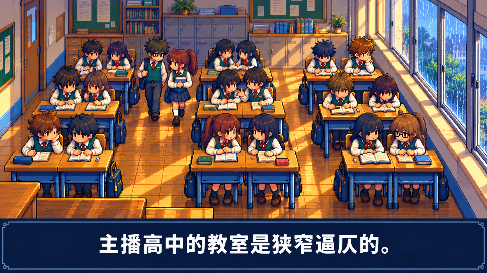
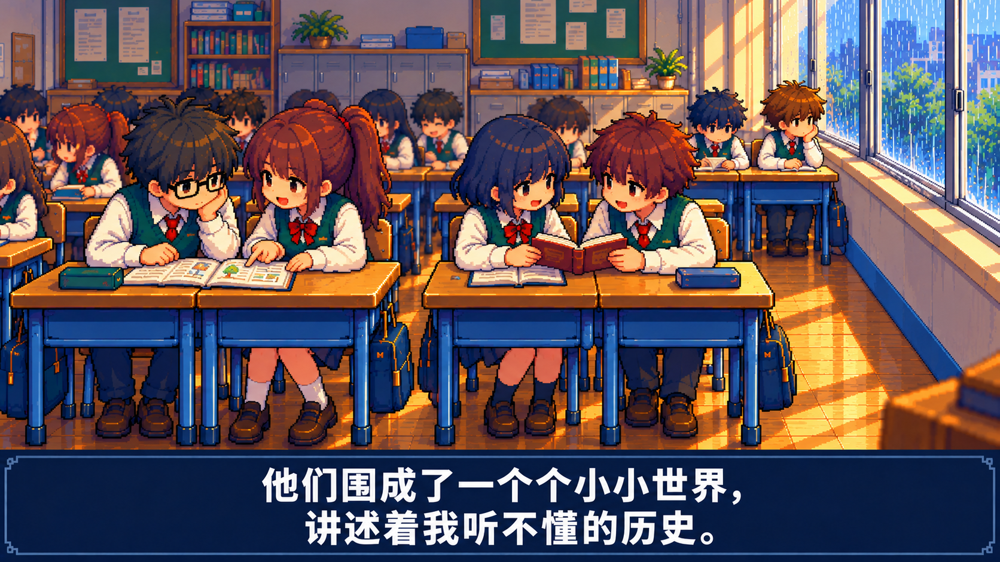
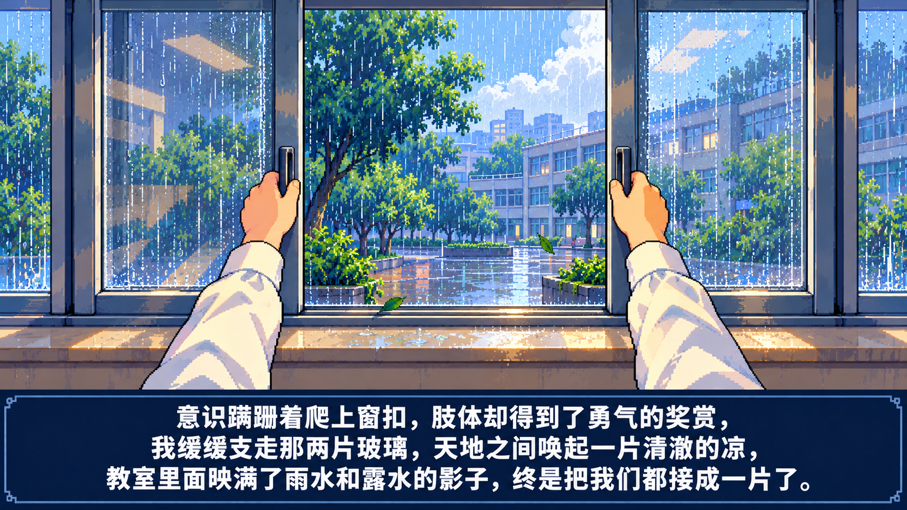

# 《窗》重制 · 四张静态镜头检查图

本轮按原文重新绘制四个时刻，沿用掌机 RPG A 强像素风、棕发绿背心主角与双人课桌。这些是供检查的静态关键图，尚未制作动画，也没有音频；正式视频仍保留全文 21 句原文、原有顺序和曼波朗读。

**[下载四张原图及说明](https://raw.githubusercontent.com/2469781075-sys/pixel-video/main/rpg-film/reboot-shots/reboot-static-keyframes.zip)**

## 1 · 教室的拥挤

> 主播高中的教室是狭窄逼仄的。

从讲台方向看向后排，用成组并桌、各自的椅子、密集的同学和通道建立教室空间。主角在最后排的靠窗座位，同桌在同组室内侧。这个反向视角中，窗墙出现在画面右侧。

## 2 · 同学的小世界

> 他们围成了一个个小小世界，讲述着我听不懂的历史。

近处的同学指着书本交流、阅读和相互注视；远处主角安静坐在窗边。以具体互动表现他与人群的距离，重新绘制群像构图。

## 3 · 第一人称推窗

> 意识蹒跚着爬上窗扣，肢体却得到了勇气的奖赏，我缓缓支走那两片玻璃，天地之间唤起一片清澈的凉，教室里面映满了雨水和露水的影子，终是把我们都接成一片了。

切到第一人称，双手握住横向推拉窗的把手。固定外框、水平轨道和叠开的玻璃共同表现中间的开口。字幕展示这一整句原文；未来动画会按朗读进度显示，同一时刻的字幕量另行安排，保留完整台词。

## 4 · 开窗后的清凉

> 我享受这份拥抱，因为它赞许了我们的自由。

从后排通道朝黑板方向看，同一窗墙因此投影在画面左侧。主角坐在自己的椅子上感受风，同桌位留下空椅和物品；纸页、发梢与窗光表现开窗后的状态变化。本目录采用已去掉多余鞋子轮廓的修正版。

## 检查与后续制作依据

- 四张均为独立构图，旧图只用于角色和画风参考。
- 逐图目视核对了对应原文、大字幕、主角与并桌的位置、窗框和窗轨。第 4 张脚边的额外鞋子已通过图片工具修正。静态检查不能代替后续动作与遮挡检查。
- 图 1、2 朝后墙，图 4 朝前墙，窗户在画面左右的差异来自视角，房间窗墙没有换边。
- 这四张抽取的是第 2、7、14、15 句的时刻，用于评估画面；完整作品仍需逐句覆盖原文，不能把这些抽取的句子当作全部旁白。
- 当前字幕直接绘在图片中，用于检查大小和排版。正式动画从原文及曼波实测时间轴单独渲染字幕；单镜头固定相机，新增内容以动作、独立场景和情绪变化为依据。
- 讲台的完整一层高台结构、逐帧推窗时的手部接触、背景同学的连续动作仍需在对应正式镜头中检查。本轮不把静态图说明为已通过用户验收或已完成重制成片。

[镜头与原文记录](shots.json) · [生成及修图提示记录](asset-prompts.json) · [文件检查记录](verification.json)
