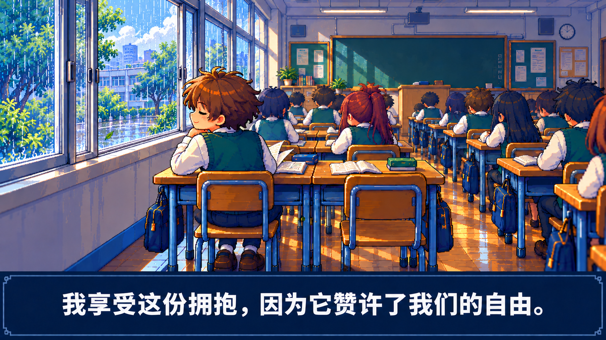

# 第四张 · 更强像素对照

以「开窗后的清凉」原图为编辑目标，使用内置 image_gen 加强像素表现。保留主角、同组双人桌、空同桌位、左侧横向推拉窗和原文大字幕。这是同一镜头的画风试稿，尚未获用户确认，也不是新增剧情镜头或动画。

改动集中在更大的色块、清晰的阶梯边缘、收紧的明暗层次和较少的细碎纹理。原图保留在上级目录。

**[下载更强像素原图](https://raw.githubusercontent.com/2469781075-sys/pixel-video/main/rpg-film/reboot-shots/pixel-strength/04-after-opening-stronger-pixel.png)** · [生成提示与约束](asset-prompt.json)

## 原版

## 更强像素版

目视检查：树叶、头发、桌椅和反光的色块更大；主角仍由自己的椅子支撑，保留两只鞋，同桌空椅与原文字幕仍在。像素网格和调色板是生成时的美术目标，未把提示中的逻辑分辨率或颜色数写成程序保证。完整动作及其他镜头尚未按这版重制。
