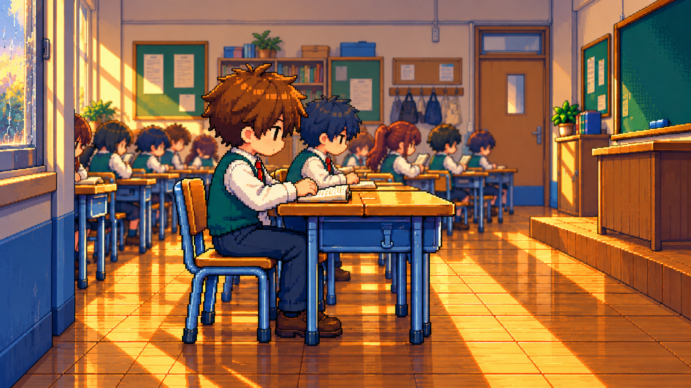

# 《窗》分镜与座位结构重绘检查

用户对第二版的反馈属实：镜头数量增加并未保证叙事信息增加。渲染器通过 `fixed_crop` 对旧画面反复裁切；`hero-with-mate.png` 的人物、椅子和课桌朝向不一致，前方出现额外空椅，无法构成可信的坐姿。固定像素区域、字幕和音频检查不能发现或排除这些原画结构错误。

本目录保存重新绘制的**结构检查图**，还不是新的完整动画或已批准的正式分镜。旧视频与素材继续保存，不能把此目录的检查图解释为成片已修好。

使用内置 image_gen 重新生成侧面构图，再独立修正房间墙面方向。新图没有从旧画面裁切或缩放得到。棕发、绿背心、白衬衫、红领带和掌机 RPG 像素视觉继续沿用。提示记录见 [asset-prompts.json](asset-prompts.json)。

## 本轮目视检查

- 主角朝右面对课桌，椅背在身体后方，臀部落在可见椅座上；大腿水平伸向桌下，膝盖弯曲，鞋底接地。画面中可以看清这些关系。
- 主角和同桌使用同组并桌及各自的椅子，没有在桌前另放空椅，也没有用两排课桌夹住主角。
- 相机位于窗墙一侧，主角在靠窗一侧，同桌在室内一侧；左侧窗边与右侧前墙/黑板/一层高台相互对应。背景原先错误地放在对面墙的窗户已改成教室内墙。
- 这是对重点结构的目视检查，背景同学还需要在最终镜头中逐个复核。没有用像素指标声称所有人体和美术细节都已正确。

## 完整重制的镜头依据

| 原文段落 | 需要新增的叙事信息与画面 | 独立原画与动作要求 |
| --- | --- | --- |
| 教室狭窄、桌列、讲台、后面留空 | 通过真实过道、桌列和高台说明空间 | 狭窄教室全景、桌列侧面、高台视角、后排通道分别设计，裁切不算新原画 |
| 同学各自取乐、小小世界 | 展示具体的阅读和交谈组合，主角与他们的距离 | 独立群像构图和自然的递书、指书、转头姿态，身体仍坐在各自椅子上 |
| 靠窗、想开窗、灼热目光、沉默 | 主角处境和实际犹豫 | 正常座位上的望窗、他人视线方向、主角手部迟疑，不能只把脸放大 |
| 同桌不在、总是开了 | 离席是一个实际状态变化 | 同桌从同一座位离开，留下自己的空椅与物品；主角转身朝窗，座位不移动 |
| 爬上窗扣、支走玻璃 | 从主角第一人称看完整开窗过程 | 固定外框、窗轨、玻璃和手分别设计，先搭空间与接触动作再逐帧运动 |
| 雨露、清凉、拥抱、自由 | 开窗改变了同一教室里的感受 | 从窗边看入室内的独立构图，头发、纸页、光与同学反应发生局部变化 |
| 河流、意气风发、骑士 | 主角的心理联想发生变化 | 为河流边界、社交想象和骑士动作绘制独立场景及角色姿态，不用一张河景和城堡图反复裁切 |
| 保持现状、跑不出教室、夜色 | 想象结束，现实约束仍在 | 有叙事理由地回到最初座位构图，但更换夜色和人物状态，结尾留住窗光 |

每个镜头以原文、动作和新增信息为依据；最终 21 句字幕仍整句保留，继续使用 66 号大字幕与原曼波实测时间轴。本轮没有重新渲染第二版，旧图中的问题仍存在。

## 已有技能与本轮调整

项目已有内置图片工具配套的 imagegen、社区 Pixel Art Studio、社区 FFmpeg、Remotion 以及项目专用 pixel-video-production。增加第三方包尚无明确必要；本轮直接把用户指出的问题加入项目专用技能的 [分镜与坐姿复核规则](../../.agents/skills/pixel-video-production/references/shot-review.md)，以后制作必须读取。没有下载新模型、换配音或用安装日志代替画面改进。
