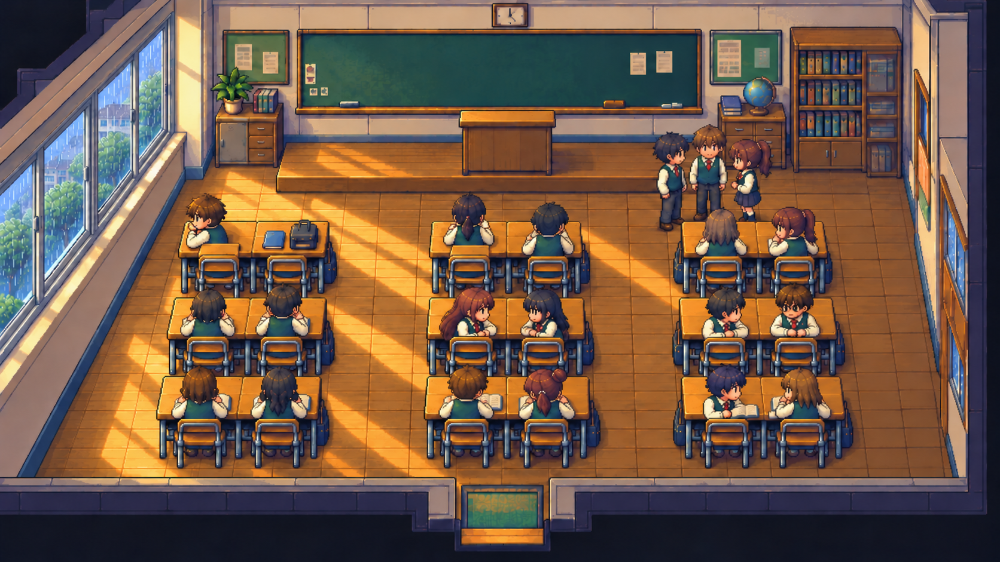
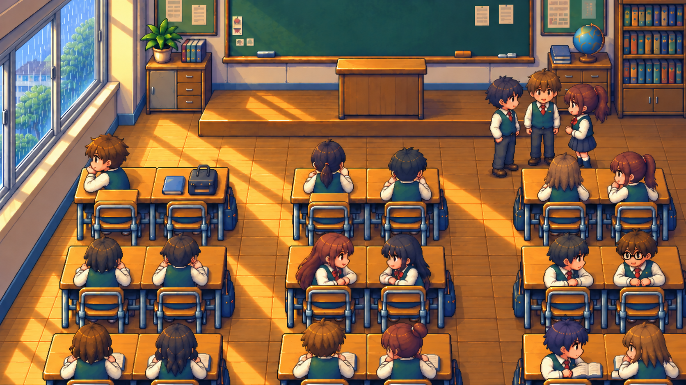
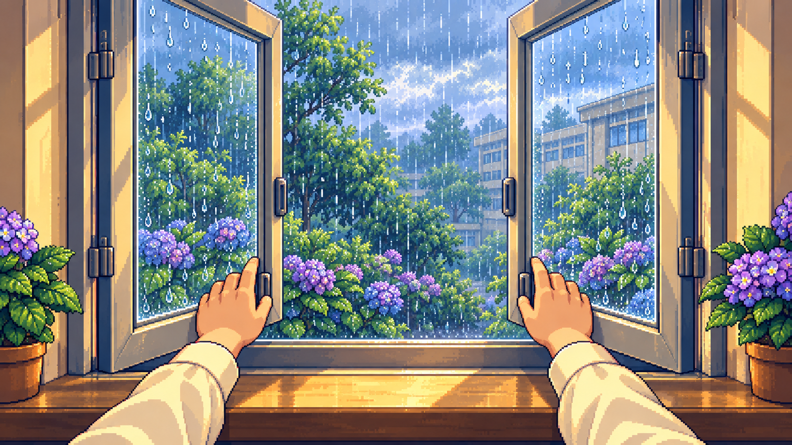
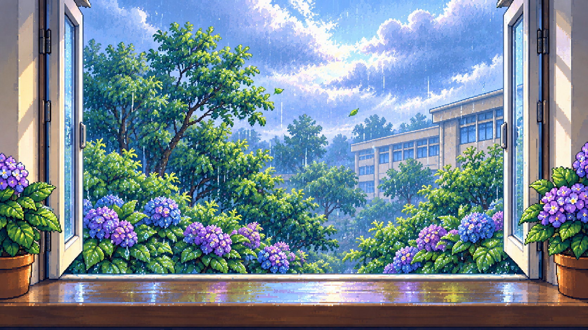

# 静态关键帧检查 · 掌机 RPG A

图 1、图 2 根据用户意见重做：中国教室的横向推拉窗、两两并排的双人课桌、靠窗主人公与暂时空着的同桌位置，以及高出学生地面一层的讲台。画风沿用掌机 RPG A。

本轮进一步修正第二列最后一排两位同学的坐姿：腰与身体朝向讲台，交流以小幅转头和轻微前倾表现；头、颈、肩、手臂保持自然连接，前臂落在各自桌面，坐姿由对应椅子支撑。图 1、图 2 同步调整同一组人物。

图 3、图 4 暂时保留上一版参考，其平开窗结构已经不符合最新要求，正式制作前须同步改成左右推拉窗。本轮没有制作动画。既有动画与曼波配音保留；[上一版四图](https://github.com/2469781075-sys/pixel-video/tree/bc9738264b0a52bdfde561c511ec6e0613274001/rpg-film/scene-review)保存在版本历史中。

## 01 · 教室全景

## 02 · 同学近景

## 03 · 第一人称开窗（上一版，窗户待同步修改）

## 04 · 开窗后的视野（上一版，窗户待同步修改）

[下载四张原图与规划](static-keyframes.zip)。以下是本轮镜头提案与检查标准，实际动画阶段仍需单独制作角色动作和窗扇运动。

| 图 | 镜头与检查重点 | 对应原文 |
| --- | --- | --- |
| 01 | 教室全景：左墙一排同高宽窗，窗台下为实墙；双人桌成组排列，组间留过道；主角坐在靠窗桌后的椅子上，同桌的另一半课桌与空椅保留；黑板前有明确的高台与台阶，讲桌在台上。检查同学、桌椅的接触与遮挡。 | 「主播高中的教室是狭窄逼仄的。」及前方“山坳”“庙”的空间比喻 |
| 02 | 同学近景：沿用图 1 的窗型、双人桌和高台，表现同桌之间与小群同学的交流；主角有完整自己的座位，不夹在两张桌子之间。检查鞋底与地面、身体与椅子的支撑关系。 | 「他们围成了一个个小小世界，讲述着我听不懂的历史。」 |
| 03 | 上一版只保留第一人称构图参考。下一版从主人公眼睛看窗，只露双手与袖口，窗扇沿轨道左右滑动，不能沿合页向外转动。 | 「但是，说不清道不明，趁着同桌不在，挟着自怜和愿望，我总是开了。」 |
| 04 | 上一版只保留窗外光色参考。下一版延续相同推拉窗，双手放下、出现真实滑开的通风口，视野转向清凉的窗外，雨、露与风改变光色。保留窗框与室内边缘。 | 「意识蹒跚着爬上窗扣，肢体却得到了勇气的奖赏，我缓缓支走那两片玻璃，天地之间唤起一片清澈的凉，教室里面映满了雨水和露水的影子，终是把我们都接成一片了。」 |

正式片将采用明确的镜头切换，每个镜头保持稳定；环境微动与人物小动作不能带动整个画面抖动。全景、同学近景、第一人称之间切换时保持教室方位、人物服装与同一窗户的结构一致。

窗户采用横向推拉结构，左右窗扇始终在与外墙平行的轨道中移动，上下轨道与外框保持固定；滑动后形成的通风口不能超过真实窗框范围。窗台下为实墙。课桌两两并排、每组两把椅子；主人公的同桌位属于同一组，不位于过道。讲台高出学生地面一层，以台阶立面和讲桌高度体现原文的比喻。人物动作时保留接地阴影和正确的前后遮挡。

图片内留出干净画面，不直接生成文字。正式视频逐句使用用户原文字幕，按已生成的 139 秒曼波朗读时间轴安排镜头；开窗前约在第 13 句（66.94–74.80 秒），风进入的第 14 句为 75.05–90.69 秒。静态图片是画面提案，不能视为动画、字幕或动作制作已经完成。
