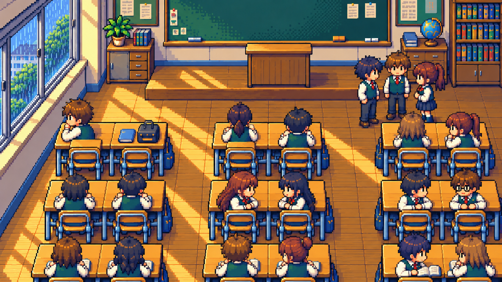

# 像素感强化 · 静态对照

用户要求保留当前几张图，并尝试更强的像素风格。原来的四张关键帧与下载包继续保留，本目录另存一张同学近景的风格候选，供比较。

这版强化可见的像素块、阶梯轮廓和分层色块阴影，减少柔滑渐变与绘画质感。保留可爱人物、横向推拉窗、双人课桌、高一层的讲台和已修正的第二列末排坐姿。它是静态风格样张，尚未替换正式镜头规划中的原图。

## 当前保留版

## 更强像素版

[下载更强像素版原图](02-classmates-strong-pixel.png) · [返回四张保留图](../README.md)

对照时主要检查：像素块是否足够清楚、人物表情和肢体是否仍然自然、桌椅与窗户是否保持清晰、整体是否仍然精致。动画阶段每个镜头保持稳定，并保证人物与背景使用一致的像素尺度。
