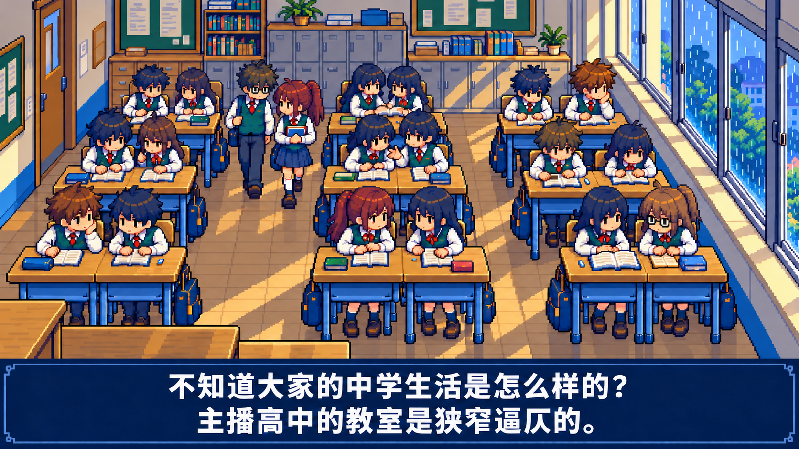
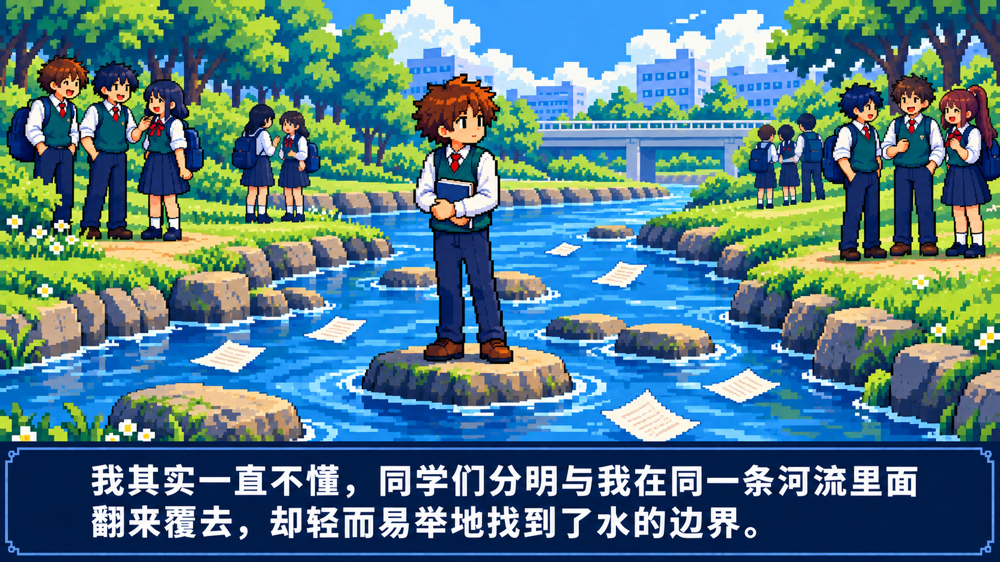

# 轻颗粒试稿

在上一轮两张画风调整图上，用内置 image_gen 增加少量材质颗粒，供用户对照检查。当前仍为静态图片，原有 16 张分镜、两张画风试稿和视频文件均保留。

颗粒以低对比的像素纹理为主，集中在地板、柜门、墙面、石头和部分草木上。人物面部与大字幕保持清楚，河面继续使用成组的蓝色色块。这是美术试稿，纹理密度与像素网格不作精确数值保证；正式动画采用时应把这些纹理固定在材质上，避免逐帧随机噪点闪烁。

**[下载两张轻颗粒原图](https://raw.githubusercontent.com/2469781075-sys/pixel-video/main/rpg-film/style-refinement-review/grain-light/two-light-grain-keyframes.zip)** · [最终编辑提示及来源](asset-prompts.json)

## 1 · 教室

### 上一轮画风与眼睛修正版

### 轻颗粒版

> 不知道大家的中学生活是怎么样的？
>
> 主播高中的教室是狭窄逼仄的。

核对最左边前排托腮棕发男生的双眼、同桌座位、横向窗框与大字幕。新增纹理主要用于背景与物体表面，不以颗粒遮盖眼睛问题。

## 2 · 河流边界

### 上一轮画风调整版

### 轻颗粒版

> 我其实一直不懂，同学们分明与我在同一条河流里面翻来覆去，却轻而易举地找到了水的边界。

石头与草木增加少量像素质感，河面维持宽阔的色带，人物与原文字幕仍清楚。

## 检查记录

两张结果已目视检查构图、人物、字幕及纹理效果，仍待用户美术验收。文件检查验证 PNG 可读性、尺寸和原有图片字节未变；这些检查不代表人体或画风已获用户认可。

[文件检查记录](verification.json) · [上一轮两图对照](../README.md) · [完整 16 图分镜](../../complete-storyboard/README.md)
