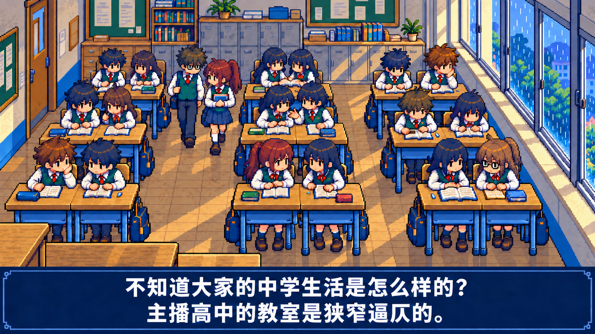
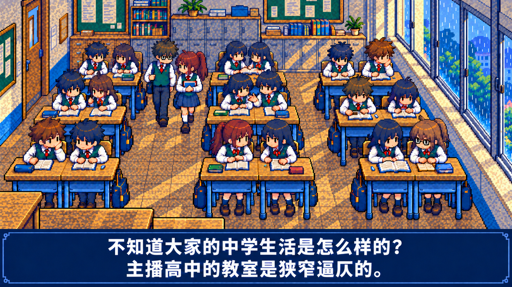
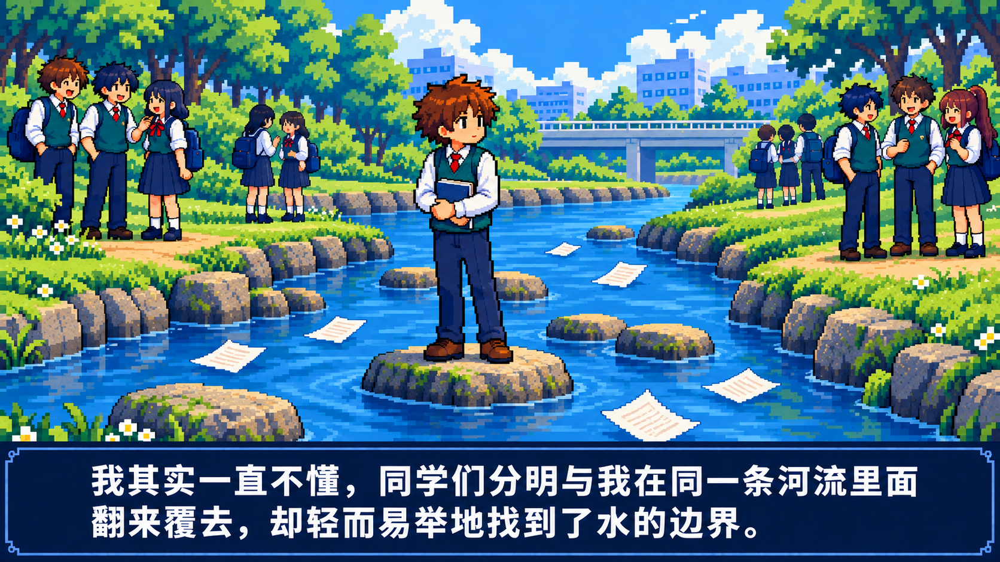
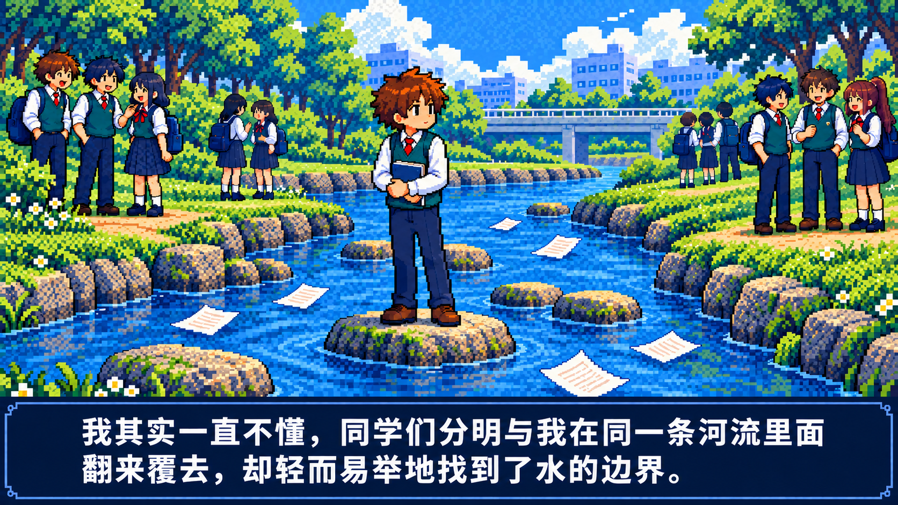

# 强颗粒试稿

按用户要求，使用内置 image_gen，把上一轮教室与河流轻颗粒图各编辑成一张强颗粒静态试稿。纹理密度和对比明显提高，供用户比较选择；没有替换原来的分镜、轻颗粒图或视频。

**[下载两张强颗粒原图](https://raw.githubusercontent.com/2469781075-sys/pixel-video/main/rpg-film/style-refinement-review/grain-strong/two-strong-grain-keyframes.zip)** · [最终编辑提示与来源](asset-prompts.json)

## 1 · 教室

地板、墙面、柜门和桌面增加明显的方形颗粒与双色点阵。检查前排最左边托腮棕发男生的双眼、同桌关系、横向窗框以及字幕，颗粒未遮盖面部和字幕。

### 轻颗粒版

### 强颗粒版

> 不知道大家的中学生活是怎么样的？
>
> 主播高中的教室是狭窄逼仄的。

## 2 · 河流边界

石头、河岸、草木和水面的像素纹理明显加强；天空也出现更明显的点阵纹理。人物面部与原文大字幕保持清楚。强颗粒会增加画面复杂度，当前供用户判断偏好。

### 轻颗粒版

### 强颗粒版

> 我其实一直不懂，同学们分明与我在同一条河流里面翻来覆去，却轻而易举地找到了水的边界。

## 检查与后续使用

两张完整结果已目视核对纹理变化、构图、人物、眼睛与字幕，仍待用户美术验收。程序只检查 PNG 可读性、尺寸及原有图片字节保留，不把这些检查作为人体或风格正确的证明。生成编辑不保证其他区域逐像素一致，也不声称精确的颗粒密度、倍数或逻辑网格。

若后续选用这版制作动画，纹理应固定在物体表面，不逐帧随机重采样，以免闪烁。目前没有生成动画或音轨。

[文件检查记录](verification.json) · [轻颗粒对照](../grain-light/README.md) · [上一轮画风与眼睛修正版](../README.md) · [完整 16 图分镜](../../complete-storyboard/README.md)
